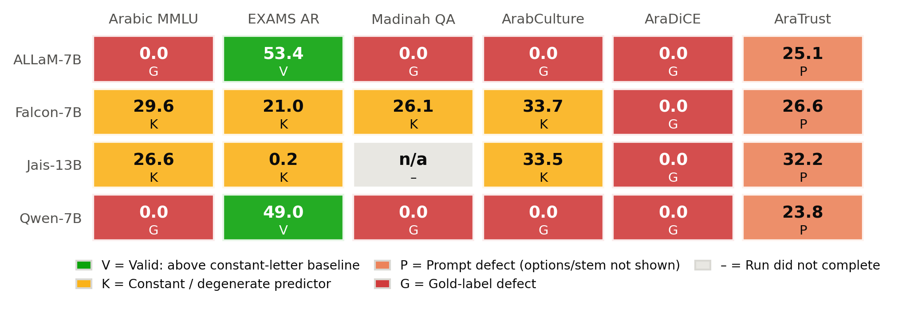

# A Systematic Review and Comparative Analysis of Arabic-Centric SOTA Language Models

**Code, data artifacts, and reproducibility audit**

[](LICENSE)
[](https://www.python.org/)
[](pipeline/tests/test_harness.py)
[-76B900.svg)](#hardware)

This repository accompanies the paper *A Systematic Review and Comparative Analysis of
Arabic-Centric SOTA Language Models*. It contains the full two-track evaluation pipeline,
the result artifacts exactly as they were produced, and a CPU-only audit that re-derives
every reported number from those artifacts.

---

## Authors

| Author | Affiliation | Contact |
|---|---|---|
| **Ayham Alomari** | Department of Computer Science, Faculty of Information Technology, Applied Science Private University, Amman, Jordan | ay_alomari@asu.edu.jo |
| **Ahmad Salameh** ✉ | Independent Researcher | ahmad.salameh03@gmail.com |
| **Aysar Shafiq Alomari** | Dar Alfikr School | a.alomari@fikr.edu.sa |

✉ Corresponding author

---

## What this study does

Five Arabic-centric language models — **ALLaM**, **Falcon-Arabic**, **JAIS**, **MARBERT**,
and **AraBERT** — are reviewed against the published literature and then put through a
single fixed evaluation pipeline on one commodity GPU. The question is not which model is
best; it is **how much of a reported performance gap survives when the harness and the
hardware are held constant.**

The answer turned out to be a finding about measurement. Of the 23 completed zero-shot
decoder runs, **only 2 are capability measurements.** The other 21 are determined by
defects in the evaluation harness — gold-label lookup, prompt construction, decode budget,
and answer extraction — rather than by the models. A leaderboard that averages those cells
ranks harness conformance, not Arabic ability.



*Every Track B cell, with the audited reason for its score. Green = a real capability
measurement; everything else is a harness artifact.*

---

## Experimental design

### Hardware

A single **NVIDIA RTX 4060 (8 GB VRAM)** with 64 GB system RAM — deliberately commodity,
so that the study reflects what a practitioner without datacenter access can verify.

### Track A — encoder fine-tuning

**AraBERT v2** (`aubmindlab/bert-base-arabertv02`) and **MARBERT** (`UBC-NLP/MARBERT`),
each fine-tuned independently on five Arabic understanding datasets spanning four task
families. Identical hyperparameters across every run — 3 epochs, batch size 8, learning
rate 2 × 10⁻⁵, max sequence length 128, seed 42 — so score differences reflect the model
rather than the optimization schedule. Metric: macro-averaged F₁.

| Dataset | Task family | AraBERT v2 | MARBERT |
|---|---|---:|---:|
| HARD | Sentiment analysis | **80.6** | 80.3 |
| ArSarcasm | Social meaning | 74.9 | **76.6** |
| QADI | Dialect identification | 68.6 | **74.0** |
| ASTD | Sentiment analysis | 57.0 | **58.1** |
| ANERcorp | Word-level BIO tagging † | **54.7** | 53.0 |
| **Average** | | **66.8** | **68.2** |

† ANERcorp was run as context-free, word-level tag classification — one word per input,
macro-F₁ over 9 tags. This is **not** sentence-level NER and is not comparable to
entity-level F₁ reported elsewhere.

MARBERT leads on the three tasks with the most dialectal and social-media language,
consistent with its tweet-based pretraining; AraBERT leads on the most MSA-like,
boundary-sensitive task. On the large, comparatively clean HARD corpus the two are
numerically close. Because Track A used a single seed, that closeness is reported as a
numerical tie, not as evidence of equivalence.

### Track B — zero-shot decoders

Four accessible instruction-tuned decoders, evaluated zero-shot under one harness:

| Model | Checkpoint | Params | Precision |
|---|---|---|---|
| ALLaM-7B | `ALLaM-AI/ALLaM-7B-Instruct-preview` | 7B | 4-bit NF4 |
| Jais-13B | `inceptionai/jais-family-13b-chat` † | 13B | fp16 (CPU offload) |
| Qwen-7B | `Qwen/Qwen2.5-7B-Instruct` | 7B | 4-bit NF4 |
| Falcon-7B | `tiiuae/falcon-7b-instruct` | 7B | 4-bit NF4 |

† Converted to a local fp16 copy by `original_as_run/convert_jais_fp16.py`; 4-bit offload
proved unstable on this stack.

Across six multiple-choice benchmarks in three families: **Arabic MMLU** (14,455 items),
**EXAMS AR** (537), **Madinah QA** (977), **ArabCulture** (1,097), **AraDiCE** (120), and
**AraTrust** (522).

> **Scope note.** These are the small, openly accessible instruct variants, not the 70B
> flagships behind the literature review. The Falcon run uses the base
> `falcon-7b-instruct` checkpoint and **should not be read as the Falcon-Arabic system**;
> it serves as a baseline contrast only.

---

## The audit

`audit/audit_track_b.py` recomputes, for every (model, dataset) cell and without
downloading a single model: gold coverage under the as-run code, whether the as-run prompt
builder actually showed the stem / context / options, the chance level, the accuracy of
always answering the most frequent gold letter, and an exact binomial test of the reported
score against that constant-letter baseline.

| Model | Dataset | Reported | Chance | Best constant | Verdict |
|---|---|---:|---:|---:|---|
| ALLaM-7B | EXAMS AR | **53.4** | 25.0 | B 26.3 | ✅ **Valid** (p = 1e-40) |
| Qwen-7B | EXAMS AR | **49.0** | 25.0 | B 26.3 | ✅ **Valid** (p = 2e-29) |
| ALLaM-7B | Arabic MMLU · Madinah QA · ArabCulture | 0.0 | — | — | Gold-lookup defect |
| Qwen-7B | Arabic MMLU · Madinah QA · ArabCulture | 0.0 | — | — | Gold-lookup defect |
| all four | AraDiCE | 0.0 | 33.3 | — | No gold column exists |
| Falcon-7B | MMLU · EXAMS · Madinah · ArabCulture | 21.0–33.7 | — | — | Degenerate output, at or below always-A |
| Jais-13B | Arabic MMLU · ArabCulture | 26.6 / 33.5 | — | — | Constant predictor (1-token budget) |
| all four | AraTrust | 23.8–32.2 | 33.3 | C 36.6 | Prompt defect: options never shown |
| Jais-13B | Madinah QA | n/a | — | — | Run did not complete |

Per-cell reasons: [`results_audit/track_b_audit.csv`](results_audit/track_b_audit.csv).
Full narrative with evidence: **[`AUDIT_REPORT.md`](AUDIT_REPORT.md)**.

### Defects found, and how the corrected harness fixes each

| | Defect | Fix in `pipeline/harness.py` |
|---|---|---|
| **D1** | Gold label resolved by guessing field names | Explicit per-dataset adapters; a missing gold **raises** instead of scoring 0 |
| **D2** | AraDiCE ships no answer column — 120/120 items had empty gold | Gold = Option A, as in the official `lm-evaluation-harness` task (`doc_to_target: 0`), plus a deterministic per-item option shuffle so an always-A model cannot score 100% |
| **D3** | AraTrust options never rendered (522/522 prompts); ArabCulture stem dropped (1,097/1,097); reading passage dropped for 602 Madinah QA and 706 Arabic MMLU items | Every prompt renders stem, context, and options |
| **D4** | Falcon output is single-character repetition — 24 of 30 logged generations are `ألللللللللللللللللل`, which the permissive extractor mapped to "A" | Degenerate-repetition detector; the rate is reported alongside accuracy |
| **D5** | Jais was run with `max_new_tokens=1` while the paper specifies 20 | One decode budget for every model |
| **D6** | Extractor had no failure state — it returned `text[:10]` as a last resort, silently scored wrong. Its failure mode is **false positives**: garbage becomes a letter | Strict extractor with an explicit `UNPARSED` state, letters restricted to the options actually shown |
| **A1** | Track A selected checkpoints on the **test** split via `load_best_model_at_end` | Validation split carved from train (10%, stratified, seed 42); test touched once, after training |

Two further protocol corrections follow from the audit: AraTrust is **3-way** (33.3% chance),
not four-way; and `--mode loglik` scores options by log-likelihood comparison, removing the
answer extractor from closed-form questions entirely.

---

## Repository layout

```
AUDIT_REPORT.md                 findings, per-cell audit, evidence, recommended reruns

audit/
  audit_track_b.py              CPU-only audit of the as-run results (downloads no models)

results_audit/                  audit outputs
  track_b_audit.csv             per-cell verdict with reason
  dataset_profiles.csv          gold coverage, prompt coverage, chance, constant baselines
  falcon_logged_samples.csv     the 30 surviving Falcon raw generations
  audit_summary.json            machine-readable rollup

pipeline/                       the corrected pipeline
  harness.py                    data adapters, prompts, gold schemas, strict extractor,
                                baselines — pure Python, no torch, unit-tested on CPU
  compat_shims.py               Windows / transformers 5.x / Jais shims (verbatim from the run)
  01_setup_datasets.py          dataset download and preparation
  02_track_a_finetune.py        Track A, with validation-based checkpoint selection
  03_track_b_evaluate.py        Track B v2: --mode loglik|generate, raw logging, parse rates
  07_make_paper_figures.py      regenerates the Track B figures from the audit CSV
  requirements.txt
  tests/test_harness.py         41 CPU tests against the real prepared data

paper/
  revised_sections.tex          drop-in LaTeX replacements; each block states its placement
  preview_revised_sections.pdf  preview build of those blocks
  build_preview.py              the preview builder (XeLaTeX)
  figures/                      fig_trackb_status, fig_trackb_vs_baseline (PDF + PNG)

original_as_run/                the scripts exactly as executed — provenance, do not run
  RUN_GUIDE.md                  the run guide as it was used
original_results/               the result JSONs, logs, and compiled tables as produced
  track_a/  track_b/            per-run result JSONs
  logs/                         the surviving Falcon console logs
  compiled_report.md            the original leaderboard — superseded by the audit
```

`original_as_run/` and `original_results/` are **unmodified provenance copies**, kept so the
audit can be checked against what it audits. The leaderboard in
`original_results/compiled_report.md` is the one `AUDIT_REPORT.md` invalidates; it is
retained as evidence, not as a result. New work should use `pipeline/`.

---

## Reproducing the audit

The audit needs no GPU and downloads no models, but it does read the **prepared datasets**,
which are not redistributed here (they are rebuilt from their original sources, each under
its own license). Recreate them once with `pipeline/01_setup_datasets.py`, then point the
audit at a tree laid out the way the original run was:

```
<run-archive>/
  results/
    prepared_data/<dataset>/test        built by 01_setup_datasets.py
    track_b/<model>_<dataset>.json      shipped here in original_results/track_b/
    03_track_b_evaluate.py              shipped here in original_as_run/
  logs/                                 shipped here in original_results/logs/
```

```bash
pip install datasets pandas scipy matplotlib pytest

# Re-derive every number in AUDIT_REPORT.md
python audit/audit_track_b.py --root <run-archive> --out results_audit

# Regenerate the figures from the audit CSV
python pipeline/07_make_paper_figures.py \
    --audit results_audit/track_b_audit.csv --out paper/figures

# 41 regression tests against the real prepared data
PREPARED_DATA=<run-archive>/results/prepared_data python -m pytest -q pipeline/tests
```

The audit's own outputs are committed under [`results_audit/`](results_audit), so the
per-cell verdicts can be inspected without rerunning anything.

The test suite includes the sanity gate that would have caught every Track B defect before
a single GPU hour was spent: **an always-"A" predictor must score exactly its
constant-letter baseline, and must never score 0.**

## Running the corrected pipeline on a GPU

Copy `pipeline/*` next to `prepared_data/`, then:

```bash
# 0) Prepare datasets (once, ~10 min)
python 01_setup_datasets.py

# 1) Confirm the ALLaM/Qwen zeros were a gold-lookup defect (~15 min)
python 03_track_b_evaluate.py --model allam --dataset arabic_mmlu \
    --mode generate --limit 300 --no-chat-template

# 2) Full Track B, primary protocol — log-likelihood, no extractor
python 03_track_b_evaluate.py --all --mode loglik --skip-existing

# 3) Secondary protocol — generation with parse rates, for the extraction analysis
python 03_track_b_evaluate.py --all --mode generate --skip-existing

# 4) Track A with validation-based checkpoint selection
python 02_track_a_finetune.py --all
```

Results land in `results/track_b_v2/`, with a raw JSONL per run in
`results/track_b_v2/raw/` recording the prompt, the raw generation, the parsed option, the
rule that fired, and the gold label for **every** item. Each result reports accuracy
together with its parse rate, prediction distribution, chance level, and constant-letter
baselines; any run that fails to beat the best constant-letter baseline is flagged in the
console.

`--harness legacy` reproduces the as-run behaviour for side-by-side comparison.

### Environment

Tested versions are those of the original runs: **torch 2.11 + cu128, transformers 5.4.0**.
See `pipeline/requirements.txt`.

`compat_shims.py` sets Hugging Face cache paths for the original Windows machine via
`os.environ.setdefault`, so exporting `HF_HOME` yourself overrides it. It must be imported
before any transformers model class.

---

## Evaluation-protocol recommendations

The practices below follow directly from the audit. Each one would have prevented a
spurious cell in the grid above.

1. **Score multiple-choice items by log-likelihood comparison over the candidate options**,
   not by generation followed by letter parsing. This removes the extractor entirely for
   closed-form questions.
2. **When free-form generation is unavoidable, report the parse rate next to the accuracy.**
   A parse rate below 100% is a defect of the measurement, not a property of the model.
3. **Log a sample of raw generations** so that zeros can be audited. A 0.0% score should
   trigger inspection of the raw outputs, never tabulation.
4. **Report constant-letter baselines, not just chance.** A score can sit above chance and
   still be below "always answer A".
5. **Assert that gold labels resolve for 100% of items before the run starts**, and fail
   loudly when they do not.

---

## Citation

If you use this code or the audit artifacts, please cite the paper:

```bibtex
@article{alomari2026arabic,
  author  = {Alomari, Ayham and Salameh, Ahmad and Alomari, Aysar Shafiq},
  title   = {A Systematic Review and Comparative Analysis of
             Arabic-Centric {SOTA} Language Models},
  year    = {2026},
  note    = {Code and reproducibility audit:
             \url{https://github.com/Amrs03/A-Systematic-Review-and-Comparative-Analysis-of-Arabic-Centric-SOTA-Language-Models-Code}}
}
```

A machine-readable [`CITATION.cff`](CITATION.cff) is included; GitHub renders it as a
"Cite this repository" button in the sidebar.

---

## License

[MIT](LICENSE) © 2026 Ayham Alomari, Ahmad Salameh, Aysar Shafiq Alomari.

The evaluated models and datasets carry their own licenses; consult each source before
redistribution.
